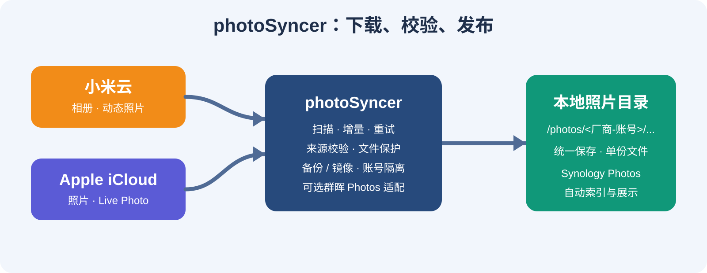

# photoSyncer

<p align="center">
  
</p>

<p align="center"><strong>把小米云和 Apple iCloud Photos 稳定地同步到自己的存储。</strong></p>

<p align="center">
  <a href="https://github.com/gorquan/XiaomiAlbumSyncer/actions"></a>
  <a href="LICENSE"></a>
</p>

<p align="center"></p>

photoSyncer 是一个面向家庭 NAS 的照片和视频同步工具。它支持小米云、Apple iCloud Photos、多账号、定时任务、失败重试和 Synology Photos 展示。

> 本项目基于上游项目 [XiaomiAlbumSyncer](https://github.com/Coooolfan/XiaomiAlbumSyncer) 开发。感谢原作者和所有贡献者提供的小米云同步基础、协议研究与早期实现。本项目保留上游的 GPL-3.0 许可证，许可证文本见 [LICENSE](LICENSE)。

## 你可以用它做什么

- 从小米云或 iCloud 选择相册，手动或定时同步照片和视频。
- 绑定多个小米、Apple 账号，账号和文件按来源隔离。
- 使用全量、时间线或位点增量扫描，减少重复处理。
- 在备份模式和镜像模式之间选择：备份保留本地文件，镜像跟随任务所选相册删除本地文件。
- 可选开启 Synology Photos 适配，让 EXIF 时间、Live Photo 配对和目录布局更适合群晖索引。
- 强制执行来源和文件完整性检查；失败资源保留状态，下一次同步继续重试。
- 每个资源最终只保留一份目标文件，不额外建立长期原件库。

录音同步已移除；小米任务不会显示 Apple Live Photo 选项。小米动态照片保持云端的原生单文件结构，Apple Live Photo 的图片和配套 MOV 会按同名文件配对。

## 最快开始：Docker Compose

需要 Git、Node.js 24.20+、JDK 25 和 Docker。

```bash
git clone https://github.com/gorquan/XiaomiAlbumSyncer.git photoSyncer
cd photoSyncer

(cd web && npm install && npm run build)
mkdir -p server/src/main/resources/static
cp -R web/dist/. server/src/main/resources/static/
(cd server && ./gradlew clean solonJar -PappVersion="$(git rev-parse --short HEAD)")

cp server/build/libs/XiaomiAlbumSyncer-$(git rev-parse --short HEAD).jar docker/app.jar
mkdir -p db download
docker compose -f docker/docker-compose.yml up -d --build
```

打开 `http://服务器IP:8232`，第一次运行时设置应用密码。这个密码只用于登录 photoSyncer，不等于小米、Apple 或 DSM 密码。

默认目录如下：

| 内容 | 宿主机默认目录 | 容器目录 |
| --- | --- | --- |
| 数据库、发布记录、临时文件 | `./db` | `/app/db` |
| 同步后的照片和视频 | `./download` | `/photos` |

群晖部署时，只需要把 `PHOTO_SYNCER_EXPORT_DIR` 指向 Photos 实际索引的目录，并把任务目标填写为容器内的 `/photos`。状态目录建议放在 Photos 索引目录之外，例如：

```yaml
PHOTO_SYNCER_STATE_DIR=/volume2/docker/photoSyncer/db
PHOTO_SYNCER_EXPORT_DIR=/volume2/photo
```

不要把宿主机路径直接填进任务；任务始终使用容器内路径 `/photos`。运行用户必须对数据库目录和照片目录有读写权限。

## 第一次配置

1. 在“设置”中绑定小米或 Apple 账号。
   - 小米推荐扫码登录；部分账号首次访问云相册时还需要完成小米云的设备或短信验证。
   - Apple 按提示登录并提交双重认证验证码。
2. 在任务页刷新相册列表，选择要同步的相册和媒体类型。
3. 选择扫描方式、备份或镜像模式、执行时间和并发参数。
4. 如果使用群晖 Photos，把目标目录设为 `/photos` 并打开“适配群晖 Photos”。
5. 先点击“立即执行”观察任务历史，确认无误后再开启定时执行。

## 关键选项

### 扫描方式

| 方式 | 小米 | iCloud | 适合场景 |
| --- | --- | --- | --- |
| 全量 | 支持 | 支持 | 第一次同步或需要完整重建 |
| 时间线 | 支持 | 不使用 | 小米按日期变化降低扫描量 |
| 位点增量 | 支持 | 支持 | 云端提供稳定变化游标时使用 |

全量会重新枚举任务所选相册，但已有完整文件会按发布记录复用。时间线和位点只缩小云端检查范围，不会跳过必要的文件完整性检查。

### 备份和镜像

- **备份**：云端删除或移出任务所选相册后，本地文件继续保留。
- **镜像**：只要资源不再属于任务所选相册，本地托管文件就会在下一次成功同步中清理。
- 镜像只看当前任务选择的相册；照片仍在云端其他相册，不影响本任务的删除判断。
- 小米位点增量只支持备份；其他组合按界面可选项为准。

### Synology Photos 适配

- 关闭：保存云端下载的原始文件内容。
- 开启：在现有文件上生成适合 Photos 的 EXIF 时间和配对命名。
- 开关在下一次同步生效；已有可校验文件优先直接处理，不会无条件重新下载。
- 关闭后会清理本任务生成的适配文件，并恢复可用的云端原件；再次开启会从现有文件继续生成缺失适配。
- 适配和普通同步共用同一个账号目录，最终不额外保留一套长期原件。

## 文件布局

无论是否开启 Photos 适配，任务都使用统一根目录，并按厂商、账号和图库隔离：

```text
/photos/icloud-1/<图库>/asset_<资源>.heic
/photos/icloud-1/<图库>/asset_<资源>.mov
/photos/xiaomi-2/<图库>/asset_<资源>.jpg
```

同一资源出现在多个所选相册时只保存一份。状态目录中的 `media/receipts` 保存发布记录，`media/work` 只存放处理期间的临时文件；新版不再写入长期 `originals` 原件库。

## 完整性和群晖限制

文件校验是强制的：小米使用云端 SHA-1，iCloud 使用传输结果、文件大小、媒体容器和 Live Photo 结构检查。校验失败会保留任务状态并在后续同步重试。

群晖 Photos 的预览和播放仍取决于 DSM、Photos、Synology Image Assistant、媒体编码和客户端能力。photoSyncer 不修改群晖数据库、不写入 `@eaDir`，也不会删除云端照片。

## 开发和验证

```bash
(cd web && npm run lint && npm run format && npm run build)
(cd server && ./gradlew clean compileKotlin test apiE2eJvm)
(cd xas-mock && go test ./...)
```

协议说明、群晖实机结果和删除边界见：

- [Synology Photos 使用说明](docs/synology-photos.md)
- [云端删除验证](docs/plan/cloud-deletion-validation.md)
- [iCloud Photos 开发参考](docs/icloud-api.md)
- [第三方声明](docs/THIRD_PARTY_NOTICES.md)

## 致谢与许可证

感谢 [Coooolfan/XiaomiAlbumSyncer](https://github.com/Coooolfan/XiaomiAlbumSyncer) 的原始项目、协议研究和同步实现。本项目是在其基础上的继续开发，保留原项目的 GPL-3.0 许可证和归属信息。

本项目新增代码同样按 [GNU GPL v3](LICENSE) 发布。
